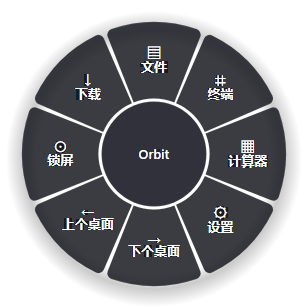
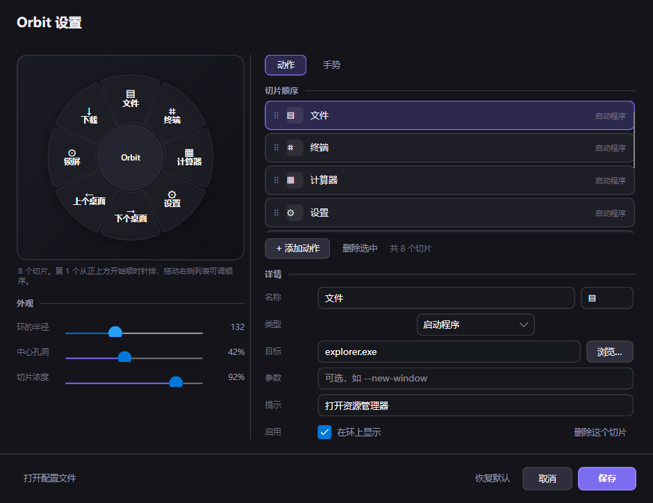
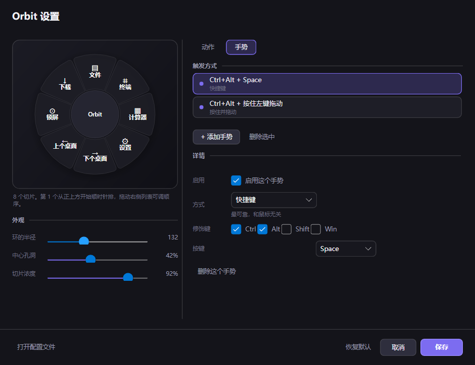
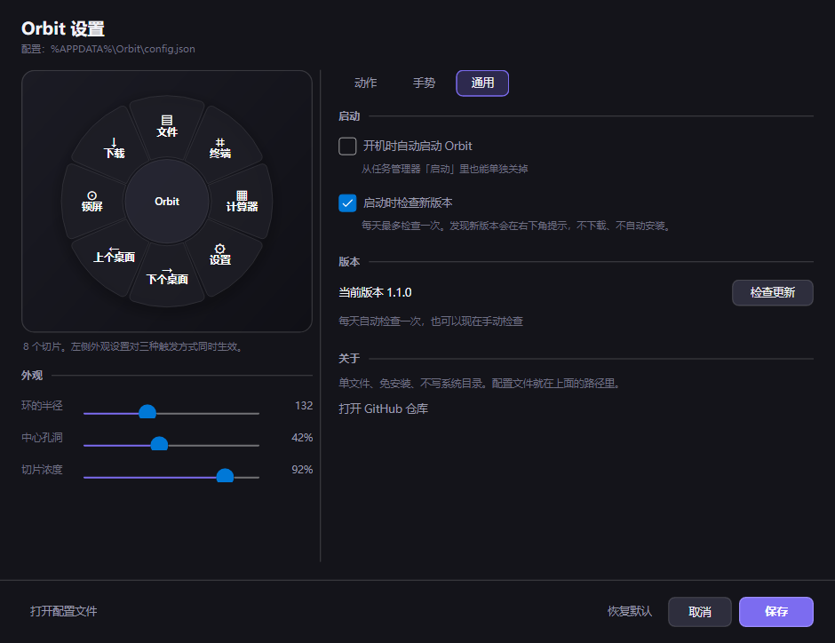

<div align="center">

# Orbit

**环形桌面操作中枢** — 按一次快捷键，常用动作出现在光标旁边，选完就走。

不打开窗口，不切换应用，不打断手上的事。

[](https://github.com/ZerOscar/Orbit/actions/workflows/ci.yml)
[](LICENSE)
[](https://dotnet.microsoft.com/)
[](#系统要求)
[](https://avaloniaui.net/)

[功能](#功能) · [安装](#安装) · [使用](#使用) · [配置](#配置) · [架构](#架构) · [开发](#开发) · [FAQ](#faq)

</div>



---

## 这是什么

大多数「快捷启动器」是另一个窗口：呼出、找、回车、窗口关掉。中间那一下窗口切换会打断你的思路。

Orbit 换个做法——把一组动作摆成一个环，**直接浮在光标位置**（不是屏幕中央，不是你上次点的地方），鼠标甩过去松手就执行，整个过程没有窗口获得焦点，你正在操作的软件不知道自己被打断过。

三条设计原则的思路参考了社区里的环形（径向）菜单方案，代码全部自己实现：

- **不抢焦点**。透明浮层 `ShowActivated = false`，拖拽时上游程序的拖放不会被劫持。
- **不猜意图**。环上永远是固定的 8 个位置，肌肉记忆一次就建立；不做「智能排序」，位置漂移比多点一下更烦。
- **不联网**。没有账号、没有遥测、没有自动更新。纯本地单文件，断网一样用。

## 功能

| | |
|---|---|
| **光标处弹出** | 快捷键按下时实时 `GetCursorPos`，环心就是光标；贴边时整环钳进工作区，不会有一半在屏幕外 |
| **三种手势** | 快捷键（`Ctrl+Alt+Space`）、按住修饰键拖拽、长按不动——都能改，也能关 |
| **拖拽直出** | 按住 `Ctrl+Alt` 拖出一段距离即弹出，拖到切片上松手直接执行，不用先呼出再点 |
| **全自绘渲染** | 一个 `Control` 手绘圆角环 + 弹簧动画 + 错峰入场，零子控件、零图片资源 |
| **可视化设置** | 左侧永远显示环本身，改半径、孔洞、浓度、顺序都即时反映；保存即生效，不用重启 |
| **拖拽重排** | 列表里按住行上下拖，环上的顺序实时跟着变 |
| **开机自启** | 设置里一个开关，写当前用户的 `Run` 项，不需要管理员权限。启动时自动对齐，被清理工具删了会补回来 |
| **更新提醒** | 启动后静默比对 GitHub 上的最新版本，有新版的在右下角提示一次，不下载、不自动安装 |
| **单文件分发** | 45 MB 一个 exe，双击即用，目标机器不需要装 .NET |

## 安装

### 直接下载（推荐）

到 [Releases](../../releases) 下载 `Orbit-win-x64.zip`，解压得到 `Orbit.exe`，双击运行。

首次启动会在 `%TEMP%\.net\Orbit\` 解压 Avalonia/Skia 的原生库（一次性，之后不再重复），随后常驻托盘。

### 从源码构建

需要 [.NET 9 SDK](https://dotnet.microsoft.com/download/dotnet/9.0)。

```bash
git clone https://github.com/ZerOscar/Orbit.git
cd Orbit
dotnet run --project src/Orbit.App
```

打包成单文件：

```powershell
.\build\publish.ps1                # → dist\win-x64\Orbit.exe
.\build\publish.ps1 -Zip           # 顺带压一个 zip
```

### 系统要求

- Windows 10 1809+ / Windows 11（x64；ARM64 用 `-Rid win-arm64` 自行编译）
- 自包含版无需安装任何运行时；源码构建需要 .NET 9 SDK

## 使用

| 操作 | 说明 |
|---|---|
| `Ctrl + Alt + Space` | 在光标处打开 / 关闭菜单 |
| `Ctrl + Alt + 左键拖拽` | 拖出一段距离弹出，拖到切片松手直接执行 |
| 点击切片 | 执行该动作并收起 |
| 点击中心孔洞 / 环外空白 / `Esc` | 关闭 |
| 托盘图标 | 打开菜单、暂停手势、**设置…**、打开配置文件、重新加载、退出 |

默认 8 个动作：文件、终端、计算器、设置、下个桌面、上个桌面、锁屏、下载。

> 所有手势都能在设置里改，包括修饰键组合、拖动灵敏度、长按时长。切片顺序即环上顺序，第 1 个从正上方开始顺时针排。

## 更新

程序启动 6 秒后（避开启动高峰）静默问一次 GitHub 上的最新 Release，只读版本号，不下载任何东西。

- **有新版**：右下角弹一张卡片，没人理它 8 秒后自己消失；托盘菜单顶部同时出现「发现新版本 vX.Y.Z」。点卡片打开 Release 页，下载新的 exe 覆盖旧的就行。
- **没新版，或者网络不通**：完全不打扰，只在日志里留一行。
- **频率**：24 小时内最多问一次；**同一个版本只提醒一次**——不会每次开机都弹。
- **不想要**：设置 → 通用 → 取消「启动时检查新版本」。


不想要自动提醒也可以，手动到 [Releases](../../releases) 下最新 zip 覆盖 `Orbit.exe`。配置存在 `%APPDATA%\Orbit\`，覆盖 exe 不会丢。

## 设置界面

托盘菜单 →「设置…」。左边是真实渲染的环，改了立刻能看到。

| 动作页 | 手势页 | 通用页 |
|---|---|---|
|  |  |  |

| 能做 | 说明 |
|---|---|
| 拖拽重排切片 | 按住列表行上下拖，环上顺序实时变化 |
| 编辑切片 | 名称、图标（单字符）、类型、目标（程序/文件夹可浏览选择）、参数、悬停提示、启用 |
| 编辑手势 | 拖拽 / 长按 / 快捷键，修饰键任意组合，可调拖动灵敏度与长按时长 |
| 调外观 | 环半径、中心孔洞比例、切片浓度，左侧预览即时反映 |
| 开机自启 | 写当前用户的启动项，勾上点保存即生效，失败会当场告诉你原因（多半是安全软件拦截） |
| 检查更新 | 通用页显示当前版本，也能手动检查一次，发现有新版直接给下载页链接 |
| 恢复默认 | 需要点两次确认，不会误触 |

保存后立即生效。**打开设置期间全局手势自动暂停**——否则在设置窗口里按快捷键，菜单会弹到设置窗口头上。

## 配置

配置文件在 `%APPDATA%\Orbit\config.json`，首次启动自动生成。可以用设置界面改，也可以直接编辑后点托盘「重新加载」。

```json
{
  "SchemaVersion": 1,
  "OuterRadius": 132,
  "HoleRatio": 0.42,
  "SliceOpacity": 0.92,
  "StartWithWindows": false,
  "CheckForUpdates": true,
  "Triggers": [
    { "Kind": "KeyChord", "Modifiers": "Ctrl, Alt", "Key": "Space", "Enabled": true },
    { "Kind": "Drag", "Modifiers": "Ctrl, Alt", "Button": "Left", "DragThreshold": 0, "Enabled": true }
  ],
  "Actions": [
    { "Label": "终端", "Glyph": "⌗", "Kind": "Launch", "Target": "wt.exe", "Enabled": true },
    { "Label": "下个桌面", "Glyph": "→", "Kind": "SwitchDesktop", "Target": "next", "Enabled": true }
  ]
}
```

`Id` 由程序自动生成，手写配置时可以省略；`DragThreshold` 填 `0` 表示用默认阈值。

`StartWithWindows` 只记录你的意图，真正生效的是注册表 `HKCU\Software\Microsoft\Windows\CurrentVersion\Run` 里的 `Orbit` 项——程序在启动时和保存设置时把两边对齐，所以手改配置也能生效。

**动作类型**

| `Kind` | `Target` | 说明 |
|---|---|---|
| `Launch` | 程序路径或协议 | `wt.exe`、`ms-settings:`、`C:\...\app.exe` |
| `OpenFolder` | 文件夹路径 | 支持 `%USERPROFILE%\Downloads` |
| `SwitchDesktop` | `next` / `prev` | 切换虚拟桌面 |
| `RunCommand` | 命令行 | 走 `cmd /c`，无窗口弹出 |
| `LockScreen` | — | 锁定工作站 |

**手势类型**

| `Kind` | 触发条件 |
|---|---|
| `KeyChord` | 快捷键，修饰键 + 主键 |
| `Drag` | 按住修饰键 + 鼠标左键拖动，超过阈值弹出 |
| `Hold` | 按住修饰键不动，达到设定时长弹出 |

修饰键可任意组合：`Ctrl`、`Alt`、`Shift`、`Meta`（Win）。

## 架构

```
Orbit.sln
├─ src/Orbit.Core    纯逻辑，不依赖 UI，可单测
│   ├─ Input         手势状态机、手势描述、虚拟键表
│   ├─ Actions       动作模型
│   └─ Config        配置读写与默认值
├─ src/Orbit.App     Avalonia 外壳
│   ├─ Platform      低级钩子（P/Invoke，零第三方库）
│   ├─ Controls      环形几何（纯函数）+ 自绘环
│   ├─ Services      定位、手势分发、动作执行、托盘
│   └─ Settings      设置窗口、可拖拽重排列表、分页表单
└─ tests/Orbit.Tests xUnit
```

| 关键文件 | 职责 |
|---|---|
| `Core/Input/GestureDetector.cs` | 把原始鼠标键盘事件翻译成语义手势的纯状态机（带锁，`Configure` / `Paused`） |
| `Core/Input/TriggerGesture.cs` | 手势描述，可序列化 |
| `App/Platform/WindowsGlobalInput.cs` | `WH_MOUSE_LL` + `WH_KEYBOARD_LL`，专用线程跑消息循环 |
| `App/Controls/DonutGeometry.cs` | 切片角度、命中测试、圆角扇形轮廓——全是纯函数，所以能单测 |
| `App/Controls/DonutMenu.cs` | 自绘环、弹簧动画、错峰入场、帧循环看门狗 |
| `App/Services/RadialController.cs` | 光标处定位、工作区钳制、拖拽落点判定 |
| `App/Settings/ReorderList.cs` | 可拖拽重排列表（自绘行，顺序即 `Children` 顺序） |

`Orbit.Core` 不引用任何 UI 类型，`Orbit.App` 只做平台适配与呈现——所以手势状态机和环形几何能脱离窗口直接单测。

## 开发

```bash
dotnet build Orbit.sln                  # 构建
dotnet test tests/Orbit.Tests           # 跑单测（38 个）
dotnet run --project src/Orbit.App      # 前台运行，Ctrl+C 退出
```

### 调试开关

```bash
ORBIT_TRACE=1 dotnet run --project src/Orbit.App                     # 打印按键、落点、重排
ORBIT_SNAPSHOT=out.png dotnet run --project src/Orbit.App            # 离屏渲染一张环截图后退出
ORBIT_SETTINGS_SNAPSHOT=out.png ...                                  # 渲染设置页（ORBIT_SETTINGS_TAB=0/1/2 看动作/手势/通用页）
ORBIT_OPEN_SETTINGS=1 dotnet run --project src/Orbit.App             # 启动即开设置窗口，方便脚本操作真实窗口
ORBIT_FAKE_UPDATE=1 dotnet run --project src/Orbit.App               # 伪造一次「发现新版本」，用于验证提醒卡片
ORBIT_TOAST_SNAPSHOT=out.png ...                                     # 配合上面，把提醒卡片渲染成 PNG 后退出
ORBIT_AUTO_CHECK=1 ...                                               # 打开设置页自动点一次「检查更新」，用于截取异步结果
```

日志在 `%APPDATA%\Orbit\orbit.log`，启动行带 `启动耗时 xxxms`——改完东西可以直接对着数字看有没有变慢。

`build/` 下是开发期的自动化验证脚本（Python，纯 ctypes 驱动真实鼠标键盘）：

| 脚本 | 用途 |
|---|---|
| `verify.py` | 快捷键开合回归 |
| `cursor_test.py` | 快捷键落点检查，含贴边钳制判定 |
| `drag_test.py` | 拖拽模式端到端 |
| `settings_test.py` | 设置页拖拽重排 + 保存，之后核对 `config.json` |
| `measure_center.py` | 逐像素测每个切片的文字居中偏差 |
| `roundtrip.py` / `capture_window.py` / `crop.py` / `analyze_png.py` | 开合回归、抓窗口、裁剪、PNG 读取 |
| `shot_screen.py` | 截屏到 PNG，可指定区域；验证提醒卡片这类没有标题的窗口时用 |
| `make_icon.py` | 生成 `orbit.ico` |
| `publish.ps1` | 发布脚本，见下 |

### 打包

```powershell
.\build\publish.ps1                       # 自包含单文件 win-x64（默认，免装 .NET）
.\build\publish.ps1 -Zip                  # 顺带压 zip
.\build\publish.ps1 -Rid win-arm64        # ARM64
.\build\publish.ps1 -FrameworkDependent   # 依赖框架，25 MB，需机器已装 .NET 9 桌面运行时
.\build\publish.ps1 -ReadyToRun           # 预编译机器码
```

实测（Windows 10 19045，热启动取三次中位数）：

| 方案 | 体积 | 启动 | 备注 |
|---|---|---|---|
| 自包含单文件（默认） | 45.0 MB | 645 ms | 免装运行时 |
| 同上 + ReadyToRun | 55.2 MB | 575 ms | 只快 70 ms，性价比低 |
| 依赖框架单文件 | 25.4 MB | — | 需 .NET 9 桌面运行时 |

几个刻意的取舍：

- **不开裁剪。** Avalonia 的 XAML 加载和 `Enum.Parse` 走反射，`PublishTrimmed` 会把它们裁掉，症状是编译通过、运行时才崩。省十几 MB 不值。
- **默认自包含。** 25 MB 那版省下的体积要用「用户先装运行时」来换，对一个随手装的小工具是负分。
- **压缩只在自包含模式生效**，依赖框架模式会报单文件压缩错误，脚本里已按模式自动关闭。

> `publish.ps1` 必须保存为 **UTF-8 带 BOM**。PowerShell 5.1 会按 GBK 读无 BOM 的文件，中文注释直接导致语法错误。

### 质量基线

| 项 | 结果 |
|---|---|
| 构建 | 0 错误 0 警告（CI 里 `-warnaserror`） |
| 单测 | 38 / 38 |
| 快捷键开合 | 窗口出现（308×308）→ 再按消失 |
| 拖拽开合 | 拖过阈值弹出 → 松手在切片上执行 |
| 单实例 | 第二次启动自动退出 |
| 图标文字居中 | 逐像素测墨迹包围盒，8 个切片最大偏差 1.3 px，中心标题 0.5 px |
| 快捷键落点 | 4 个位置偏差 0 px，贴角按设计钳制 |
| 发布版 | 单文件 45 MB，快捷键开合、设置页渲染、单实例全部复验通过 |

## FAQ

**快捷键和别的软件冲突怎么办？**
托盘 →「设置…」→ 手势页，换一组修饰键或换 `Key`。也可以同时配多个手势，比如快捷键 + 拖拽并存。

**按了快捷键没反应？**
看 `%APPDATA%\Orbit\orbit.log`。常见原因：手势被托盘菜单里的「暂停手势」关掉了；或者以管理员权限运行的窗口抢走了输入（Windows 的 UIPI 限制，低级钩子收不到更高完整性级别的输入）。真要在提权窗口上用，得让 Orbit 也以管理员身份运行。

**菜单出现在光标旁边而不是正中间？**
贴屏幕边缘时整个环会被钳进工作区，所以光标不在环心。这是有意的，避免环被切成一半。

**杀软报毒？**
低级键盘/鼠标钩子是键记录器的常用手段，误报很常见。源码全在这里，可自行编译核对；不联网、不写注册表启动项。

**会收集数据吗？**
不会。没有网络请求、没有账号、没有遥测。配置文件只有 `%APPDATA%\Orbit\config.json` 和日志 `orbit.log`。

## 贡献

Issue 和 PR 都欢迎。提交 PR 前请确认：

```bash
dotnet build Orbit.sln -warnaserror
dotnet test tests/Orbit.Tests
```

改动涉及布局或绘制时，请用 `ORBIT_SNAPSHOT` 出一张图，或用 `measure_center.py` 给出数字——「我觉得对齐了」不算验证。

## 致谢

交互思路参考了社区中的环形菜单方案，本项目为独立实现，没有复用第三方代码。

UI 框架 [Avalonia](https://avaloniaui.net/)，2D 渲染 [Skia](https://skia.org/)。

## License

[MIT](LICENSE)

---

<sub>**English** — Orbit is a radial action menu for Windows that appears at your cursor. Hit a hotkey, flick to a slice, done — no window ever takes focus. Built with .NET 9 + Avalonia 11, self-drawn with spring animation, ships as a single 45 MB exe that needs no runtime. MIT licensed.</sub>
